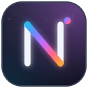

# Aladdin Ali’s engineering portfolio

A static portfolio for exploring public work in applied AI, C# and .NET, graphics, financial reconciliation, physics simulations and audio tooling. The home page pairs a draggable render comparison with a synthetic ledger. Project pages link to working labs, implementation decisions and public evidence.

## Run locally

```sh
npm ci
npm run dev
```

For the production export, run `npm run build` and serve the resulting `out/` folder with `python3 scripts/serve-preview.py --port 8000`. Open [localhost:8000](http://localhost:8000/). The labs under `public/labs/` are standalone documents and also work from the static export.

## Where to look

- [Case studies](lib/case-studies.ts) hold the selected project descriptions, actions and source references.
- [Portfolio sections](components/Portfolio.tsx) present the project visuals, background and archive.
- The [project catalog](data/projects.json) retains the existing project URLs.
- The [Naxe generator](https://github.com/NaxeCode/NaxeCode/tree/main/.github/brand) supplies the static sky, mark and palette. The site self-hosts Geist and Geist Mono.

The Pages workflow publishes changes merged into the default branch. [Live portfolio](https://naxe.dev/) · [MIT license](LICENSE)

To refresh a lab, build its original project, then run `node scripts/mirror-lab.mjs LAB EXPORT_DIRECTORY PUBLIC_SOURCE_URL UPSTREAM_LICENSE_FILE`. The script copies the reviewed files, adds the return navigation, preserves the upstream license and records SHA-256 hashes of the original files in each lab’s `provenance.json`.

## Portfolio measurement

Visitors can allow Google Analytics using the checkbox at the bottom of a portfolio or lab page. Clearing it stops collection and removes the site's GA cookies. The site also honors Do Not Track, Global Privacy Control and disabled cookies. App support and privacy pages, unknown paths, local hosts and preview deployments are excluded.

The Next.js pages and all seven standalone labs use the same collector. The site supplies approved page paths, referring origins or public paths, project slugs, control names and campaign cohorts. After opt-in, GA uses its own client and session identifiers. The Google tag runs in a separate empty document with a sanitized page location and referrer. Keep the stream’s Enhanced Measurement and user-provided data collection off in GA Admin. The Pages build uses `G-BPXEKM7YBC` by default and supports the `NEXT_PUBLIC_GA_ID` override. [Google tag settings](https://support.google.com/analytics/answer/12131703)

| Event | Meaning |
| --- | --- |
| `page_view` | An eligible page was opened. Hash changes within a lab keep the same view. |
| `case_study_view` | A project detail page was opened. |
| `lab_open` | A standalone lab loaded, including direct links. |
| `lab_interaction` | The visitor first used a measured control on this lab visit. |
| `github_click` / `source_click` | The visitor followed a GitHub link or an external lab or case-study reference. |
| `contact_click` | The visitor chose email, LinkedIn or X. |
| `tour_start` | The tour video began playing, counted once per page visit. |

Events from a project or lab carry its `project_slug`. For example, the LMMS Session lab reports `lmms-nebula`, matching the case study. `action` identifies a fixed choice such as `compare_detectors` or `email`. Counts cover visitors who opted in and whose browsers delivered the tag.

For inbound links, place all four UTM fields before any fragment. Use one shared value per cohort. For example, `https://naxe.dev/labs/cosmic-digest/?utm_source=ats&utm_medium=resume_pdf&utm_campaign=applied_ai&utm_content=v1_project1#corrections` opens the correction trial.

| Field | Accepted values |
| --- | --- |
| `utm_source` | `ats`, `recruiter`, `linkedin`, `github`, `x`, `referral`, `print` |
| `utm_medium` | `resume_pdf`, `profile`, `readme`, `repo_homepage`, `post`, `direct_message`, `email`, `qr` |
| `utm_campaign` | `applied_ai`, `dotnet`, `portfolio` |
| `utm_content` | `v1_portfolio`, `v1_project1` through `v1_project7`, `v1_cover`, `profile`, `readme`, `repo_homepage`, `portfolio`, `tour`, or a published lab or project slug |

After consent, approved cohorts survive internal navigation in the same tab for 30 minutes of inactivity. Incomplete, duplicate or unrecognized UTM values discard the cohort. Source links retain their original destinations.

Run the browser tests against a fresh export with `npx playwright-core install chromium` and `npm test`. Alternatively, use an installed Chrome with `PORTFOLIO_CHROME_CHANNEL=chrome npm test`. The test browser serves the export locally and intercepts Google requests.

To also inspect the real tag’s encoded collection payload locally, download the public Google tag script for this stream and pass its file path as `PORTFOLIO_GA_TAG_FILE` when running the tests. The wire test fulfills collection requests locally.
